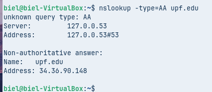

## Consulta la IP de la pàgina www.xtec.cat. Comprova que la resposta és no autoritativa.

La IP es 83.247.151.214 I la resposta no es autoritativa

## Fes una consulta usant el servidor de Google 8.8.8.8 per conèixer el NS (servidor de noms) del domini upf.edu.

Dig hace la consulta DNS, @8.8.8.8 ulitza el servidor DNS de google, upf.edu es el domini qeu consulto de NS solicita els servidor de noms de dominis

## Fes la consulta usant un dels servidors de noms de upf.edu de la pàgina www.upf.edu. Comprova com ara la resposta sí és autoritativa.

No esta autoritzat

## Consulta els dominis de correu de upf.edu.

Consulta de correou de domini

## Comprova que usant el servidor de noms de la UPF no pots fer una consulta del domini escolapia.cat.

Busco la PI del servidor UPF per posrala a la comanda per saber perque no pueden resolver el dominio escolapia.cat.

## Mostra el registre SOA del domini escolapia.cat.

Mostro els registres SOA

## Fes una consulta mDNS entre dues màquines virtuals.

Instalo el programa i comprovo que estigui habilitat i faig un ping en l'altre terminal