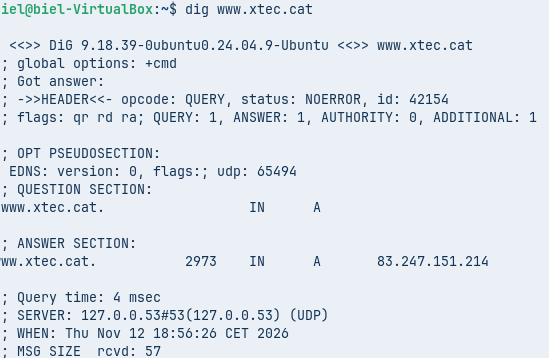
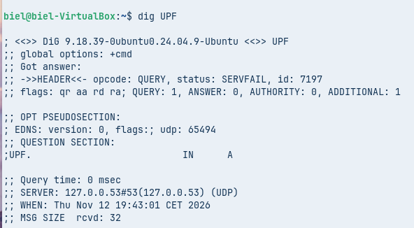
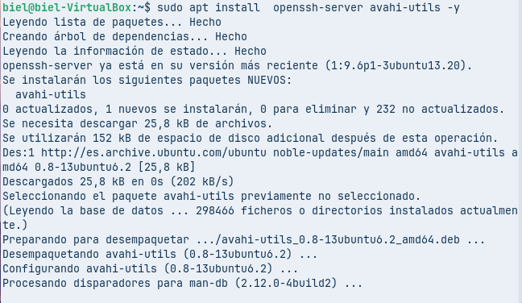
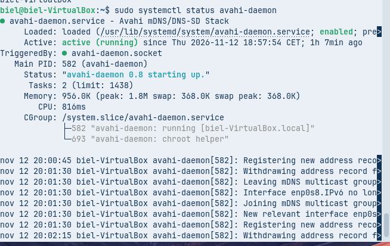

## Consulta la IP de la pàgina www.xtec.cat. Comprova que la resposta és no autoritativa.

La IP de www.xtec.cat és 83.247.151.214. La resposta és no autoritativa perquè el servidor DNS que m'ha donat la IP no és el servidor oficial del domini, sinó que ha obtingut la informació d'altres servidors DNS.

## Fes una consulta usant el servidor de Google 8.8.8.8 per conèixer el NS (servidor de noms) del domini upf.edu.

Els servidors NS del domini upf.edu són els encarregats de gestionar les seves consultes DNS. Utilitzo el servidor 8.8.8.8 de Google perquè és un servidor DNS públic que permet consultar aquesta informació.

## Fes la consulta usant un dels servidors de noms de upf.edu de la pàgina www.upf.edu. Comprova com ara la resposta sí és autoritativa.

La resposta és autoritativa perquè he consultat directament un servidor DNS de la UPF, que és responsable de gestionar el domini upf.edu i té la informació oficial d'aquest domini.

## Consulta els dominis de correu de upf.edu.

No puc obtenir la resposta del domini escolapia.cat perquè el servidor DNS de la UPF no és autoritatiu d'aquest domini i no em resol la consulta.

## Comprova que usant el servidor de noms de la UPF no pots fer una consulta del domini escolapia.cat.

El registre SOA mostra informació sobre la zona DNS, com el servidor principal, el correu de l'administrador i els temps de sincronització i actualització. Serveix per conèixer la configuració principal del domini.

## Mostra el registre SOA del domini escolapia.cat.

Faig aquesta consulta per obtenir informació principal del domini, com ara quin és el servidor DNS principal, el correu de l'administrador, el número de sèrie de la zona i els temps de refresc i actualització dels registres DNS.

## Fes una consulta mDNS entre dues màquines virtuals.

Les dues màquines virtuals es poden comunicar utilitzant mDNS, que permet resoldre noms de dispositius dins la xarxa local sense necessitar un servidor DNS convencional. Ho comprovo fent un ping entre les dues màquines.