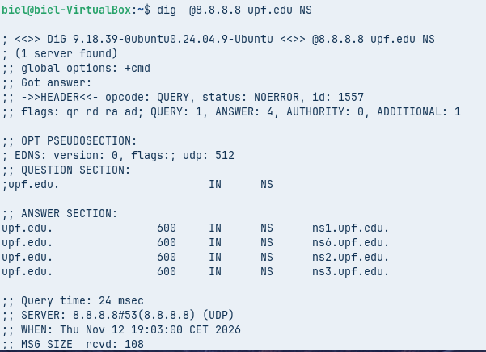
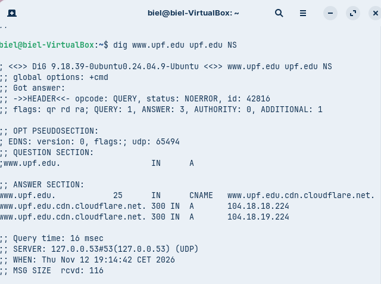
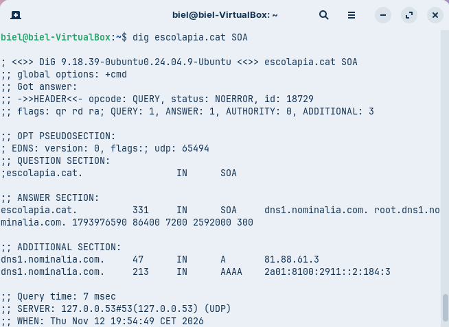

## Consulta la IP de la pàgina www.xtec.cat. Comprova que la resposta és no autoritativa.

La IP de www.xtec.cat és 83.247.151.214. La resposta és no autoritativa perquè el servidor DNS que m'ha contestat no és el servidor oficial del domini, sinó que m'ha retornat la informació que ha trobat.

## Fes una consulta usant el servidor de Google 8.8.8.8 per conèixer el NS (servidor de noms) del domini upf.edu.

La consulta m'ha retornat els servidors NS del domini upf.edu. He utilitzat el DNS de Google (8.8.8.8) perquè és un servidor públic que permet consultar quins servidors de noms gestionen aquest domini.

## Fes la consulta usant un dels servidors de noms de upf.edu de la pàgina www.upf.edu. Comprova com ara la resposta sí és autoritativa.

La resposta és autoritativa perquè he fet la consulta directament a un servidor DNS de la UPF, que és un dels servidors encarregats de gestionar el domini i té la informació oficial.

## Consulta els dominis de correu de upf.edu.

La consulta m'ha retornat els registres MX del domini upf.edu, que indiquen quins servidors s'encarreguen de rebre els correus electrònics que s'envien a aquest domini.

## Comprova que usant el servidor de noms de la UPF no pots fer una consulta del domini escolapia.cat.

No he pogut obtenir la resposta del domini escolapia.cat perquè el servidor DNS de la UPF no és el servidor autoritatiu d'aquest domini i no m'ha resolt la consulta.

## Mostra el registre SOA del domini escolapia.cat.

La consulta m'ha mostrat el registre SOA del domini escolapia.cat, on apareix informació com el servidor DNS principal, el correu de l'administrador i els temps d'actualització de la zona. Serveix per conèixer la informació principal de gestió del domini.

## Fes una consulta mDNS entre dues màquines virtuals.

He instal·lat i activat el servei mDNS a les dues màquines virtuals. Després he fet un ping utilitzant el nom de l'altra màquina i m'ha respost, demostrant que es poden trobar i comunicar a través de mDNS sense haver de posar la IP directament.